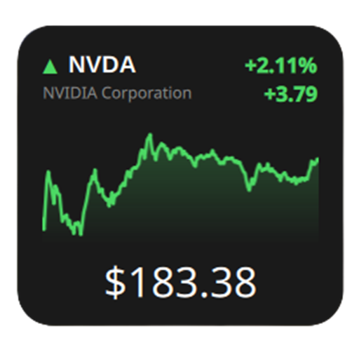
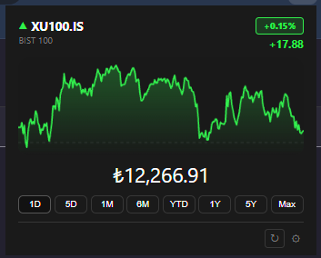
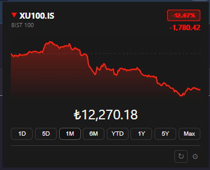
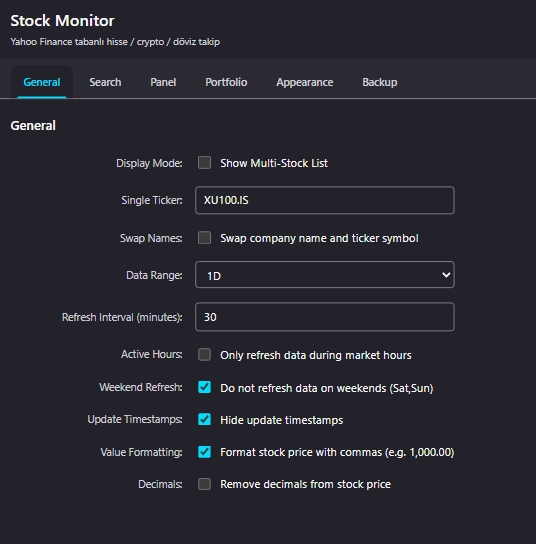
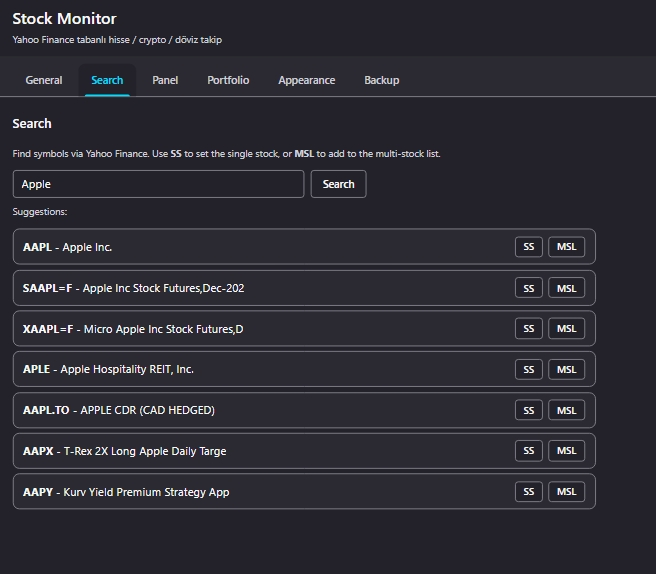
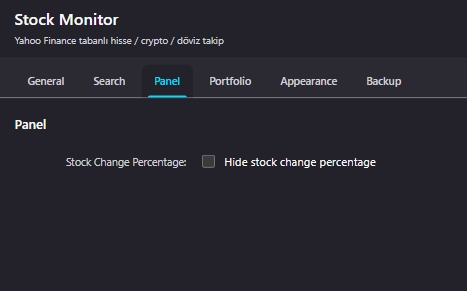
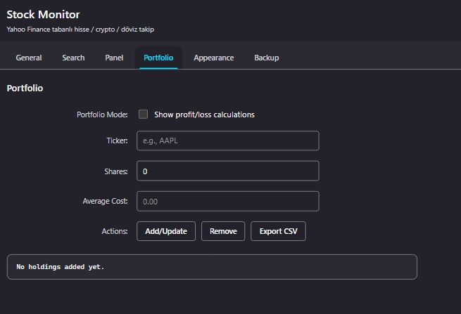
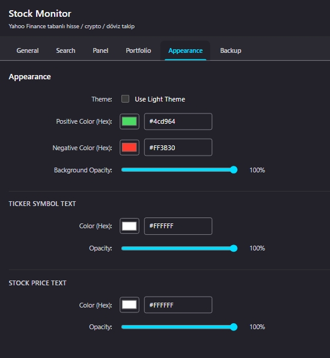
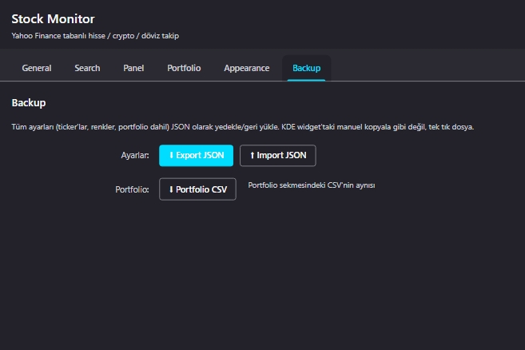

# Stock Monitor — Firefox Add-on

**English** · [Türkçe](README.tr.md)

> Firefox port of the KDE Plasma widget [`stock-monitor-widget-main`](../stock-monitor-widget-main). Same Yahoo Finance API, same features — in your browser.

<p align="center">
  
</p>

<p align="center">
  <a href="https://addons.mozilla.org/en-US/firefox/"></a>
  
  
</p>

## ✨ Features

| KDE Widget | Firefox Add-on |
|---|---|
| Yahoo Finance v8 chart | ✅ `query1.finance.yahoo.com/v8/finance/chart/{ticker}` |
| Ticker search (SS / MSL) | ✅ `query2/.../search?q=` |
| Single / Multi-Stock List | ✅ Toggle in popup |
| Chart Range 1D…Max | ✅ 1D/5D/1M/6M/YTD/1Y/5Y/Max (interval map identical) |
| Refresh 1–360 min + Battery Saver | ✅ `browser.alarms` + weekend/market-hours |
| Gradient chart + prevClose line | ✅ Canvas port |
| Colours + Light/Dark | ✅ Customisable |
| Portfolio (WIP) | ✅ shares + avgCost + CSV |
| Toolbar badge | ✅ 3 characters (`2.5`), green/red colour, full value in tooltip |
| Clicks | ✅ Left: Yahoo, Middle: refresh |

## 📸 Screenshots

**Popup — Single view** (XU100.IS · 1D / 1M range, gradient chart + previous-close line)

<p align="center">
  
  
</p>

**Settings — 6 tabs** (General · Search · Panel · Portfolio · Appearance · Backup)

<p align="center">
  
  
  
</p>
<p align="center">
  
  
  
</p>

## 🚀 Installation

### Temporary (testing)
1. `npm run build:firefox` (produces the `dist/firefox` folder)
2. `about:debugging` → This Firefox → Load Temporary Add-on
3. Select `dist/firefox/manifest.json`

### Permanent
- `npm run zip:firefox` → `web-ext-artifacts/stock_monitor-2.3.7.zip` → `about:addons` → Install from file
- After the AMO listed release, install it with one click from addons.mozilla.org

## ⚙️ Settings

`Settings →` 6 tabs (same as KDE):

- **General** — Single/Multi, ticker list, sort, swap, range, interval, market hours
- **Search** — Yahoo search + SS/MSL
- **Panel** — Hide badge
- **Portfolio** — Add/Update/Remove + CSV
- **Appearance** — Light theme, colours, opacity
- **Backup** — Export/Import JSON (all settings), Portfolio CSV

## 🔍 Symbol Examples

The same symbol codes as on `finance.yahoo.com`:

- US: `AAPL`, `TSLA`, `MSFT`
- Crypto: `BTC-USD`, `ETH-USD`
- Index: `^GSPC`, `^NSEI`
- FX: `INR=X`, `EURUSD=X`
- BIST: `THYAO.IS`, `GARAN.IS`, `XU100.IS`

## 🛠️ Development

```bash
npm install
npm run build              # src/common + src/{firefox,chrome} -> dist/
npm run build:firefox      # Firefox only
npm run build:chrome       # Chrome only

npm run start:firefox      # build + web-ext run (Firefox)
npm run lint:firefox       # web-ext lint dist/firefox
npm run lint:chrome        # web-ext lint dist/chrome
npm run zip:firefox        # AMO zip -> web-ext-artifacts/
# Chrome Web Store zip:
# zip the dist/chrome folder -> stock_monitor-chrome-2.3.7.zip
```

## 📦 Structure

```
stock-monitor-ff/
├── src/
│   ├── common/            # shared code (single source of truth)
│   │   ├── background.js  # fetch, alarm, badge (cross-browser shim)
│   │   ├── icons/icon.png
│   │   ├── popup/         # Single/Multi + canvas chart
│   │   ├── options/       # 6 tabs
│   │   └── utils/         # storage + format + api helpers
│   ├── firefox/
│   │   └── manifest.json  # gecko id, strict_min_version
│   └── chrome/
│       └── manifest.json  # Chrome Web Store (no gecko)
├── dist/
│   ├── firefox/           # build output (web-ext run/lint from here)
│   └── chrome/            # build output
├── scripts/build.js       # src -> dist copy
├── package.json
└── README.md
```

## 📄 License

GPL-3.0+ — same as the widget. Original: [vpsone/stock-monitor-widget](https://github.com/vpsone/stock-monitor-widget)

---

Made with ❤️ by [cenktekin](https://github.com/cenktekin) — PRs and screenshots welcome!
